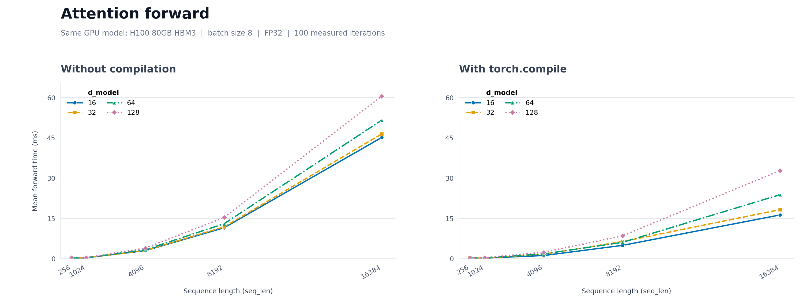
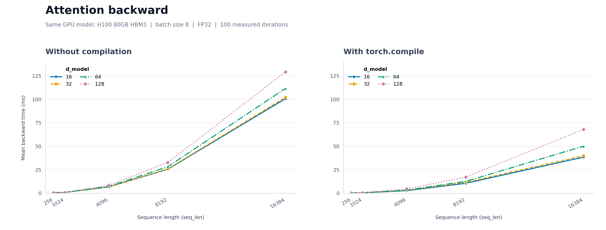
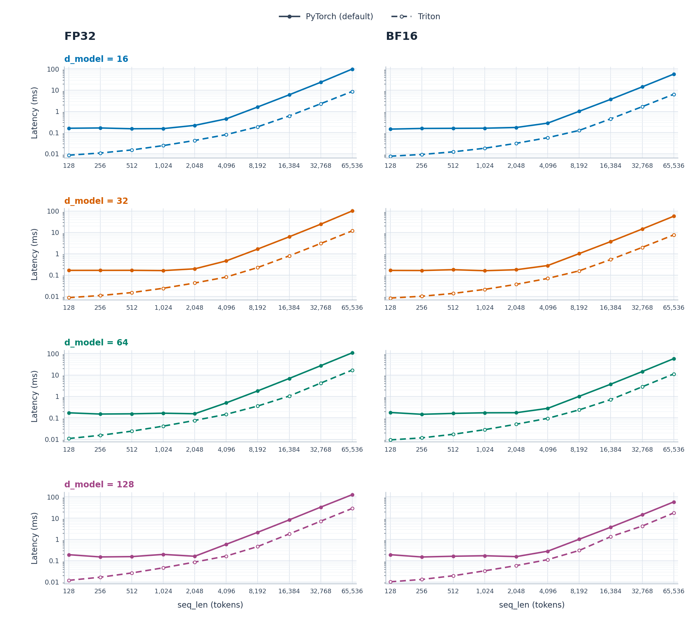
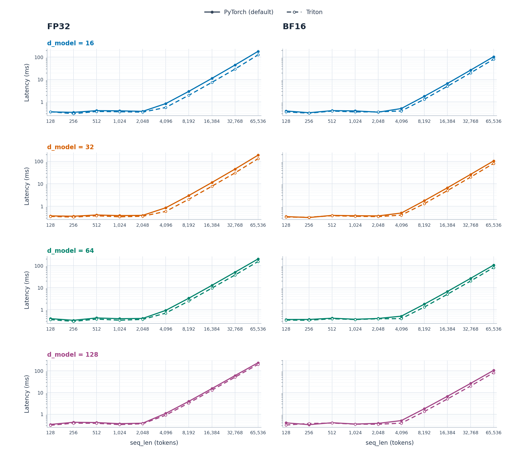
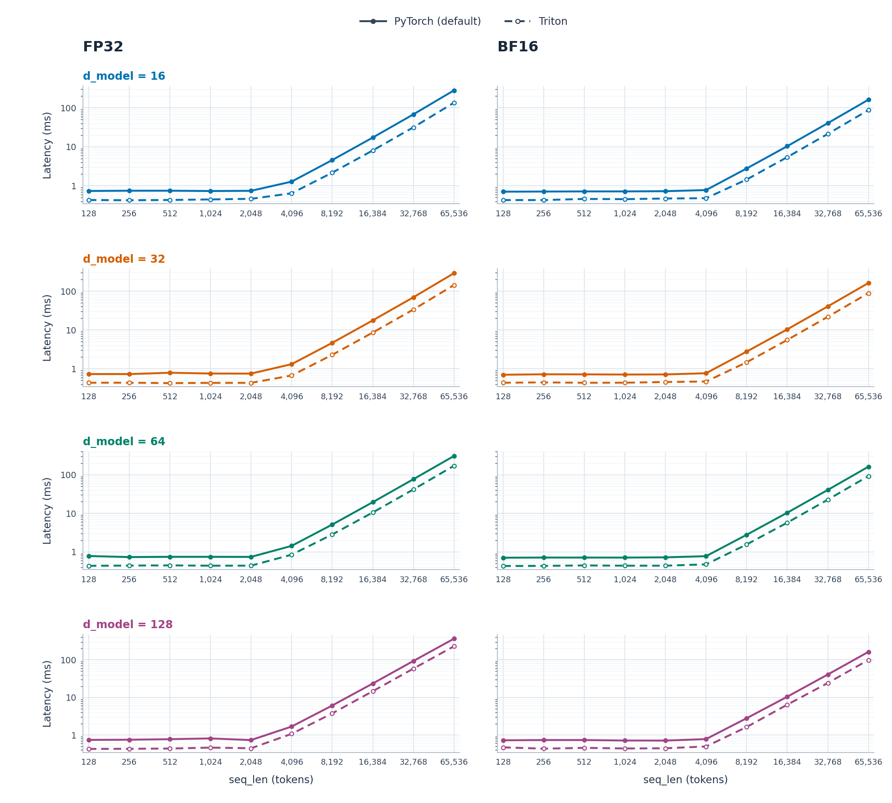

### Without compilation

| `seq_len` \ `d_model` | 16 | 32 | 64 | 128 |
| ---: | ---: | ---: | ---: | ---: |
| 256 | Forward: 0.358 ms Backward: 0.688 ms Memory: 69.02 MiB | Forward: 0.343 ms Backward: 0.633 ms Memory: 70.02 MiB | Forward: 0.338 ms Backward: 0.656 ms Memory: 72.02 MiB | Forward: 0.342 ms Backward: 0.669 ms Memory: 76.02 MiB |
| 1024 | Forward: 0.350 ms Backward: 0.770 ms Memory: 132.09 MiB | Forward: 0.358 ms Backward: 0.759 ms Memory: 136.09 MiB | Forward: 0.360 ms Backward: 0.768 ms Memory: 144.09 MiB | Forward: 0.378 ms Backward: 0.803 ms Memory: 160.09 MiB |
| 4096 | Forward: 3.007 ms Backward: 6.631 ms Memory: 1104.38 MiB | Forward: 3.062 ms Backward: 6.674 ms Memory: 1120.38 MiB | Forward: 3.349 ms Backward: 7.222 ms Memory: 1152.38 MiB | Forward: 3.951 ms Backward: 8.434 ms Memory: 1216.38 MiB |
| 8192 | Forward: 11.529 ms Backward: 25.468 ms Memory: 4192.75 MiB | Forward: 11.868 ms Backward: 25.815 ms Memory: 4224.75 MiB | Forward: 13.036 ms Backward: 28.133 ms Memory: 4288.75 MiB | Forward: 15.359 ms Backward: 32.582 ms Memory: 4416.75 MiB |
| 16384 | Forward: 45.159 ms Backward: 100.670 ms Memory: 16513.50 MiB | Forward: 46.473 ms Backward: 102.064 ms Memory: 16577.50 MiB | Forward: 51.581 ms Backward: 111.576 ms Memory: 16705.50 MiB | Forward: 60.543 ms Backward: 129.201 ms Memory: 16961.50 MiB |

### With torch.compile

| `seq_len` \ `d_model` | 16 | 32 | 64 | 128 |
| ---: | ---: | ---: | ---: | ---: |
| 256 | Forward: 0.214 ms (−40.35%) Backward: 0.348 ms (−49.43%) Memory: 69.03 MiB (+0.011%) | Forward: 0.243 ms (−29.15%) Backward: 0.352 ms (−44.39%) Memory: 70.03 MiB (+0.011%) | Forward: 0.239 ms (−29.21%) Backward: 0.345 ms (−47.37%) Memory: 72.03 MiB (+0.011%) | Forward: 0.237 ms (−30.83%) Backward: 0.340 ms (−49.22%) Memory: 76.03 MiB (+0.010%) |
| 1024 | Forward: 0.251 ms (−28.29%) Backward: 0.421 ms (−45.28%) Memory: 132.12 MiB (+0.024%) | Forward: 0.245 ms (−31.35%) Backward: 0.451 ms (−40.60%) Memory: 136.12 MiB (+0.023%) | Forward: 0.352 ms (−2.18%) Backward: 0.476 ms (−38.08%) Memory: 144.12 MiB (+0.022%) | Forward: 0.385 ms (+1.93%) Backward: 0.561 ms (−30.19%) Memory: 160.12 MiB (+0.020%) |
| 4096 | Forward: 1.190 ms (−60.43%) Backward: 2.677 ms (−59.63%) Memory: 1104.50 MiB (+0.011%) | Forward: 1.707 ms (−44.26%) Backward: 3.052 ms (−54.27%) Memory: 1120.50 MiB (+0.011%) | Forward: 1.786 ms (−46.65%) Backward: 3.272 ms (−54.70%) Memory: 1152.50 MiB (+0.011%) | Forward: 2.404 ms (−39.16%) Backward: 4.530 ms (−46.29%) Memory: 1216.50 MiB (+0.010%) |
| 8192 | Forward: 4.966 ms (−56.93%) Backward: 10.521 ms (−58.69%) Memory: 4193.00 MiB (+0.006%) | Forward: 6.374 ms (−46.29%) Backward: 11.596 ms (−55.08%) Memory: 4225.00 MiB (+0.006%) | Forward: 6.096 ms (−53.24%) Backward: 12.585 ms (−55.26%) Memory: 4289.00 MiB (+0.006%) | Forward: 8.521 ms (−44.52%) Backward: 17.162 ms (−47.33%) Memory: 4417.00 MiB (+0.006%) |
| 16384 | Forward: 16.302 ms (−63.90%) Backward: 38.390 ms (−61.87%) Memory: 16514.00 MiB (+0.003%) | Forward: 18.278 ms (−60.67%) Backward: 39.837 ms (−60.97%) Memory: 16578.00 MiB (+0.003%) | Forward: 23.847 ms (−53.77%) Backward: 50.063 ms (−55.13%) Memory: 16706.00 MiB (+0.003%) | Forward: 32.842 ms (−45.75%) Backward: 67.931 ms (−47.42%) Memory: 16962.00 MiB (+0.003%) |

## Default vs Triton

### forward

GPU: **NVIDIA H200** (143771 MiB); driver: **610.57.04**.
`regime=0` (forward-only), batch size 1, causal masking.

Rows show `seq_len` and columns show `d_model`. Each cell lists **bf16 / fp32** latency in milliseconds.

#### PyTorch (`default`)

| seq_len | 16 | 32 | 64 | 128 |
| ---: | ---: | ---: | ---: | ---: |
| 128 | 0.1460 / 0.1602 | 0.1644 / 0.1652 | 0.1781 / 0.1719 | 0.1910 / 0.1909 |
| 256 | 0.1569 / 0.1652 | 0.1627 / 0.1655 | 0.1467 / 0.1506 | 0.1490 / 0.1499 |
| 512 | 0.1590 / 0.1517 | 0.1777 / 0.1663 | 0.1616 / 0.1547 | 0.1616 / 0.1552 |
| 1024 | 0.1611 / 0.1541 | 0.1591 / 0.1614 | 0.1723 / 0.1650 | 0.1705 / 0.1972 |
| 2048 | 0.1741 / 0.2191 | 0.1771 / 0.1952 | 0.1740 / 0.1554 | 0.1552 / 0.1610 |
| 4096 | 0.2792 / 0.4444 | 0.2784 / 0.4594 | 0.2774 / 0.5003 | 0.2792 / 0.5886 |
| 8192 | 1.0137 / 1.6179 | 1.0132 / 1.6539 | 1.0134 / 1.8106 | 1.0184 / 2.1592 |
| 16384 | 3.7072 / 6.0563 | 3.7120 / 6.2200 | 3.7178 / 6.8640 | 3.7348 / 8.2516 |
| 32768 | 14.3555 / 23.6287 | 14.3879 / 24.2804 | 14.4102 / 27.0214 | 14.4542 / 32.8200 |
| 65536 | 57.2785 / 98.8987 | 57.3018 / 101.4326 | 57.5226 / 107.6955 | 57.7860 / 126.7265 |

#### TritonFlashAttention (`triton`)

| seq_len | 16 | 32 | 64 | 128 |
| ---: | ---: | ---: | ---: | ---: |
| 128 | 0.0077 / 0.0086 | 0.0083 / 0.0087 | 0.0094 / 0.0109 | 0.0102 / 0.0119 |
| 256 | 0.0093 / 0.0109 | 0.0101 / 0.0109 | 0.0117 / 0.0154 | 0.0131 / 0.0167 |
| 512 | 0.0124 / 0.0152 | 0.0137 / 0.0150 | 0.0172 / 0.0240 | 0.0196 / 0.0265 |
| 1024 | 0.0183 / 0.0244 | 0.0212 / 0.0239 | 0.0282 / 0.0412 | 0.0334 / 0.0462 |
| 2048 | 0.0313 / 0.0426 | 0.0365 / 0.0422 | 0.0506 / 0.0760 | 0.0587 / 0.0859 |
| 4096 | 0.0576 / 0.0804 | 0.0693 / 0.0803 | 0.0953 / 0.1464 | 0.1120 / 0.1648 |
| 8192 | 0.1269 / 0.1877 | 0.1575 / 0.2248 | 0.2366 / 0.3560 | 0.3023 / 0.4625 |
| 16384 | 0.4459 / 0.6122 | 0.5332 / 0.7930 | 0.7118 / 1.0410 | 1.3486 / 1.8044 |
| 32768 | 1.6686 / 2.2866 | 1.9776 / 3.0223 | 2.8068 / 4.1718 | 4.2236 / 7.1591 |
| 65536 | 6.4310 / 8.7012 | 7.6293 / 11.7942 | 11.1310 / 16.9120 | 17.5156 / 28.4628 |

Both axes use a logarithmic scale. FP32 and BF16 share the Y-axis limits within each row.

### backward

GPU: **NVIDIA H200** (143771 MiB); driver: **610.57.04**.
`regime=1` (backward-only), batch size 1, causal masking.

Rows show `seq_len` and columns show `d_model`. Each cell lists **bf16 / fp32** latency in milliseconds.

#### PyTorch (`default`)

| seq_len | 16 | 32 | 64 | 128 |
| ---: | ---: | ---: | ---: | ---: |
| 128 | 0.3940 / 0.3584 | 0.3482 / 0.3733 | 0.3562 / 0.3895 | 0.3980 / 0.3358 |
| 256 | 0.3281 / 0.3414 | 0.3170 / 0.3614 | 0.3580 / 0.3281 | 0.3283 / 0.4228 |
| 512 | 0.4082 / 0.4072 | 0.3946 / 0.4112 | 0.4090 / 0.4196 | 0.4042 / 0.4112 |
| 1024 | 0.3968 / 0.3994 | 0.3811 / 0.3864 | 0.3658 / 0.3888 | 0.3506 / 0.3645 |
| 2048 | 0.3485 / 0.3788 | 0.3741 / 0.3951 | 0.3977 / 0.3989 | 0.3766 / 0.3839 |
| 4096 | 0.5066 / 0.8423 | 0.5028 / 0.8626 | 0.5055 / 0.9272 | 0.5063 / 1.0911 |
| 8192 | 1.7858 / 2.9742 | 1.7808 / 3.0259 | 1.7807 / 3.3074 | 1.7918 / 3.9370 |
| 16384 | 6.6967 / 11.3015 | 6.6991 / 11.5122 | 6.7057 / 12.7044 | 6.7387 / 15.2812 |
| 32768 | 26.2908 / 44.5343 | 26.3035 / 45.3464 | 26.3212 / 50.0911 | 26.4056 / 60.6734 |
| 65536 | 105.0312 / 182.5321 | 105.0934 / 189.1742 | 105.4446 / 200.7155 | 105.8319 / 238.2849 |

#### TritonFlashAttention (`triton`)

| seq_len | 16 | 32 | 64 | 128 |
| ---: | ---: | ---: | ---: | ---: |
| 128 | 0.3576 / 0.3649 | 0.3318 / 0.3556 | 0.3356 / 0.3531 | 0.3164 / 0.3083 |
| 256 | 0.3148 / 0.2975 | 0.3267 / 0.3319 | 0.3298 / 0.2928 | 0.3724 / 0.3844 |
| 512 | 0.3900 / 0.3750 | 0.3818 / 0.3792 | 0.3859 / 0.3718 | 0.3896 / 0.3794 |
| 1024 | 0.3573 / 0.3632 | 0.3589 / 0.3421 | 0.3562 / 0.3315 | 0.3462 / 0.3314 |
| 2048 | 0.3609 / 0.3499 | 0.3480 / 0.3618 | 0.3842 / 0.3598 | 0.3428 / 0.3617 |
| 4096 | 0.3933 / 0.5646 | 0.4058 / 0.5934 | 0.3910 / 0.6964 | 0.3849 / 0.9044 |
| 8192 | 1.3238 / 1.9843 | 1.3161 / 2.0625 | 1.3161 / 2.4663 | 1.3309 / 3.2929 |
| 16384 | 4.9956 / 7.4772 | 5.0072 / 7.8181 | 5.0165 / 9.5168 | 5.0582 / 12.8540 |
| 32768 | 19.7890 / 29.3868 | 19.8534 / 30.7029 | 19.9049 / 37.4022 | 19.9900 / 51.1988 |
| 65536 | 81.2535 / 126.8448 | 81.3223 / 131.9123 | 81.7565 / 153.7212 | 82.2693 / 200.5837 |

Both axes use a logarithmic scale. FP32 and BF16 share the Y-axis limits within each row.

### forward + backward

GPU: **NVIDIA H200** (143771 MiB). Driver: **610.57.04**.
`regime=2` (forward + backward), batch size 1, causal masking.

Rows show `seq_len` and columns show `d_model`. Each cell lists **bf16 / fp32** latency in milliseconds.

#### PyTorch (`default`)

| seq_len | 16 | 32 | 64 | 128 |
| ---: | ---: | ---: | ---: | ---: |
| 128 | 0.7065 / 0.7365 | 0.7020 / 0.7309 | 0.7040 / 0.7796 | 0.7204 / 0.7386 |
| 256 | 0.7117 / 0.7481 | 0.7209 / 0.7310 | 0.7105 / 0.7312 | 0.7316 / 0.7468 |
| 512 | 0.7173 / 0.7484 | 0.7179 / 0.7908 | 0.7099 / 0.7430 | 0.7318 / 0.7721 |
| 1024 | 0.7180 / 0.7343 | 0.7105 / 0.7557 | 0.7094 / 0.7425 | 0.7106 / 0.8079 |
| 2048 | 0.7274 / 0.7438 | 0.7153 / 0.7527 | 0.7200 / 0.7392 | 0.7081 / 0.7315 |
| 4096 | 0.7778 / 1.2812 | 0.7691 / 1.3151 | 0.7722 / 1.4292 | 0.7774 / 1.6762 |
| 8192 | 2.7831 / 4.5745 | 2.7774 / 4.6683 | 2.7770 / 5.1088 | 2.7924 / 6.0820 |
| 16384 | 10.3724 / 17.3295 | 10.3750 / 17.6973 | 10.3829 / 19.5417 | 10.4336 / 23.5102 |
| 32768 | 40.5180 / 68.0717 | 40.5633 / 69.5362 | 40.6316 / 77.0042 | 40.7611 / 93.4189 |
| 65536 | 161.9621 / 281.0169 | 162.1004 / 290.5577 | 162.7421 / 308.8907 | 163.1984 / 365.7995 |

#### TritonFlashAttention (`triton`)

| seq_len | 16 | 32 | 64 | 128 |
| ---: | ---: | ---: | ---: | ---: |
| 128 | 0.4307 / 0.4325 | 0.4371 / 0.4374 | 0.4296 / 0.4337 | 0.4665 / 0.4252 |
| 256 | 0.4311 / 0.4261 | 0.4465 / 0.4377 | 0.4323 / 0.4401 | 0.4322 / 0.4283 |
| 512 | 0.4600 / 0.4334 | 0.4364 / 0.4279 | 0.4433 / 0.4451 | 0.4530 / 0.4352 |
| 1024 | 0.4541 / 0.4468 | 0.4380 / 0.4340 | 0.4369 / 0.4368 | 0.4371 / 0.4596 |
| 2048 | 0.4719 / 0.4629 | 0.4563 / 0.4340 | 0.4372 / 0.4378 | 0.4423 / 0.4422 |
| 4096 | 0.4807 / 0.6436 | 0.4700 / 0.6731 | 0.4727 / 0.8437 | 0.4938 / 1.0718 |
| 8192 | 1.4485 / 2.1728 | 1.4727 / 2.2871 | 1.5557 / 2.8226 | 1.6278 / 3.7552 |
| 16384 | 5.4360 / 8.0898 | 5.5351 / 8.6036 | 5.7255 / 10.5644 | 6.4055 / 14.6475 |
| 32768 | 21.4655 / 31.6852 | 21.8485 / 33.7064 | 22.6969 / 41.7920 | 24.2244 / 58.5038 |
| 65536 | 87.6618 / 135.6387 | 88.9144 / 143.8311 | 92.8099 / 171.9781 | 99.6153 / 229.8581 |

Both axes use a logarithmic scale. FP32 and BF16 share the Y-axis limits within each row.
