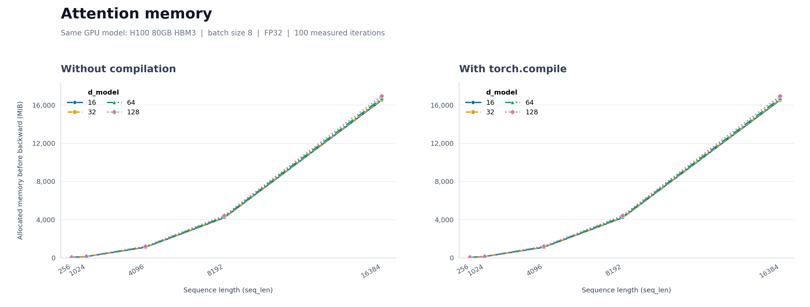

### Without compilation

| `seq_len` \ `d_model` | 16 | 32 | 64 | 128 |
| ---: | ---: | ---: | ---: | ---: |
| 256 | Forward: 0.358 ms Backward: 0.688 ms Memory: 69.02 MiB | Forward: 0.343 ms Backward: 0.633 ms Memory: 70.02 MiB | Forward: 0.338 ms Backward: 0.656 ms Memory: 72.02 MiB | Forward: 0.342 ms Backward: 0.669 ms Memory: 76.02 MiB |
| 1024 | Forward: 0.350 ms Backward: 0.770 ms Memory: 132.09 MiB | Forward: 0.358 ms Backward: 0.759 ms Memory: 136.09 MiB | Forward: 0.360 ms Backward: 0.768 ms Memory: 144.09 MiB | Forward: 0.378 ms Backward: 0.803 ms Memory: 160.09 MiB |
| 4096 | Forward: 3.007 ms Backward: 6.631 ms Memory: 1104.38 MiB | Forward: 3.062 ms Backward: 6.674 ms Memory: 1120.38 MiB | Forward: 3.349 ms Backward: 7.222 ms Memory: 1152.38 MiB | Forward: 3.951 ms Backward: 8.434 ms Memory: 1216.38 MiB |
| 8192 | Forward: 11.529 ms Backward: 25.468 ms Memory: 4192.75 MiB | Forward: 11.868 ms Backward: 25.815 ms Memory: 4224.75 MiB | Forward: 13.036 ms Backward: 28.133 ms Memory: 4288.75 MiB | Forward: 15.359 ms Backward: 32.582 ms Memory: 4416.75 MiB |
| 16384 | Forward: 45.159 ms Backward: 100.670 ms Memory: 16513.50 MiB | Forward: 46.473 ms Backward: 102.064 ms Memory: 16577.50 MiB | Forward: 51.581 ms Backward: 111.576 ms Memory: 16705.50 MiB | Forward: 60.543 ms Backward: 129.201 ms Memory: 16961.50 MiB |

### With torch.compile

| `seq_len` \ `d_model` | 16 | 32 | 64 | 128 |
| ---: | ---: | ---: | ---: | ---: |
| 256 | Forward: 0.214 ms (−40.35%) Backward: 0.348 ms (−49.43%) Memory: 69.03 MiB (+0.011%) | Forward: 0.243 ms (−29.15%) Backward: 0.352 ms (−44.39%) Memory: 70.03 MiB (+0.011%) | Forward: 0.239 ms (−29.21%) Backward: 0.345 ms (−47.37%) Memory: 72.03 MiB (+0.011%) | Forward: 0.237 ms (−30.83%) Backward: 0.340 ms (−49.22%) Memory: 76.03 MiB (+0.010%) |
| 1024 | Forward: 0.251 ms (−28.29%) Backward: 0.421 ms (−45.28%) Memory: 132.12 MiB (+0.024%) | Forward: 0.245 ms (−31.35%) Backward: 0.451 ms (−40.60%) Memory: 136.12 MiB (+0.023%) | Forward: 0.352 ms (−2.18%) Backward: 0.476 ms (−38.08%) Memory: 144.12 MiB (+0.022%) | Forward: 0.385 ms (+1.93%) Backward: 0.561 ms (−30.19%) Memory: 160.12 MiB (+0.020%) |
| 4096 | Forward: 1.190 ms (−60.43%) Backward: 2.677 ms (−59.63%) Memory: 1104.50 MiB (+0.011%) | Forward: 1.707 ms (−44.26%) Backward: 3.052 ms (−54.27%) Memory: 1120.50 MiB (+0.011%) | Forward: 1.786 ms (−46.65%) Backward: 3.272 ms (−54.70%) Memory: 1152.50 MiB (+0.011%) | Forward: 2.404 ms (−39.16%) Backward: 4.530 ms (−46.29%) Memory: 1216.50 MiB (+0.010%) |
| 8192 | Forward: 4.966 ms (−56.93%) Backward: 10.521 ms (−58.69%) Memory: 4193.00 MiB (+0.006%) | Forward: 6.374 ms (−46.29%) Backward: 11.596 ms (−55.08%) Memory: 4225.00 MiB (+0.006%) | Forward: 6.096 ms (−53.24%) Backward: 12.585 ms (−55.26%) Memory: 4289.00 MiB (+0.006%) | Forward: 8.521 ms (−44.52%) Backward: 17.162 ms (−47.33%) Memory: 4417.00 MiB (+0.006%) |
| 16384 | Forward: 16.302 ms (−63.90%) Backward: 38.390 ms (−61.87%) Memory: 16514.00 MiB (+0.003%) | Forward: 18.278 ms (−60.67%) Backward: 39.837 ms (−60.97%) Memory: 16578.00 MiB (+0.003%) | Forward: 23.847 ms (−53.77%) Backward: 50.063 ms (−55.13%) Memory: 16706.00 MiB (+0.003%) | Forward: 32.842 ms (−45.75%) Backward: 67.931 ms (−47.42%) Memory: 16962.00 MiB (+0.003%) |

