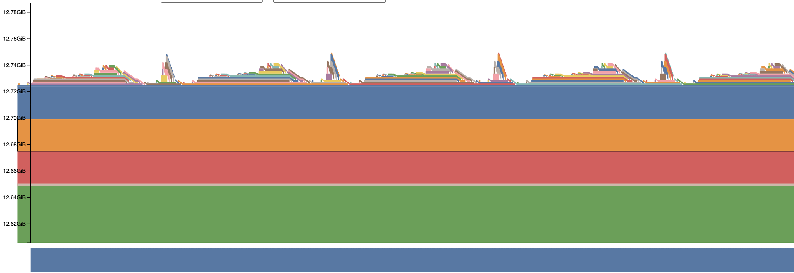
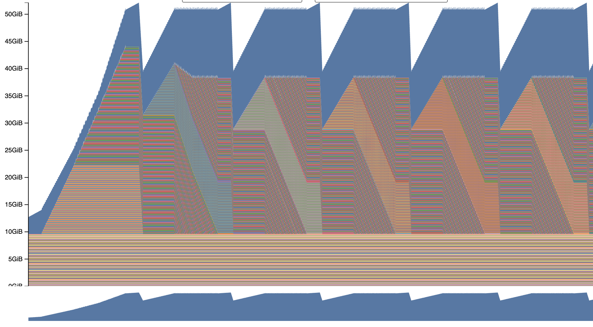
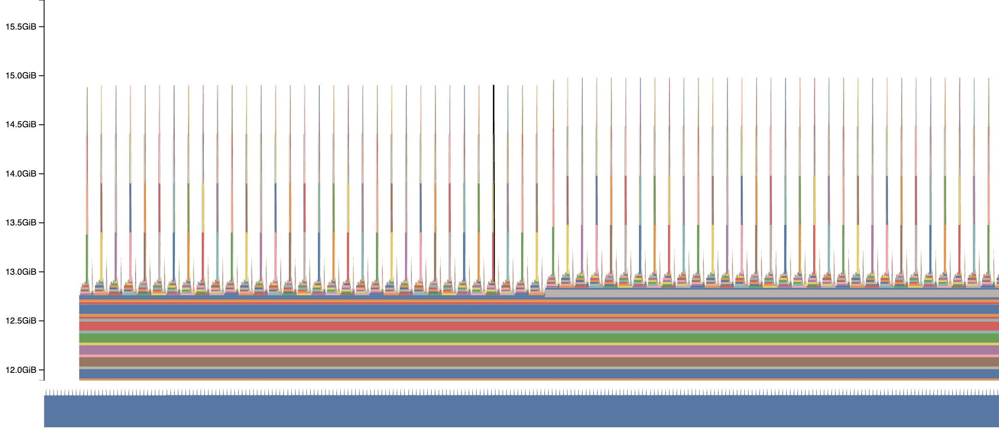
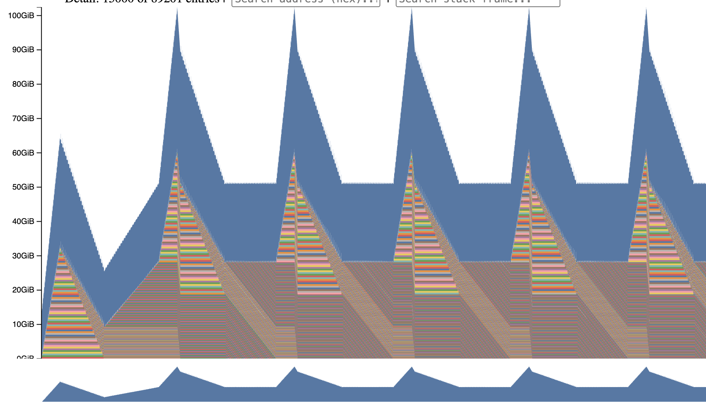
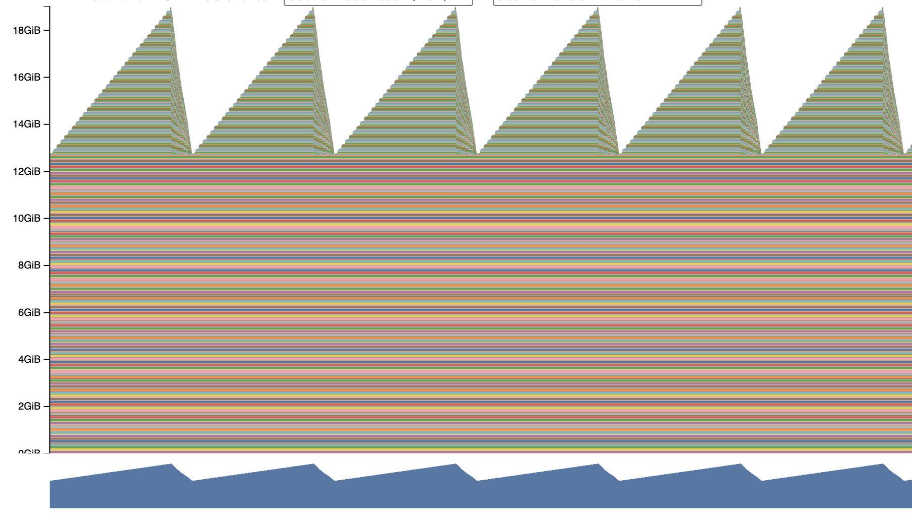
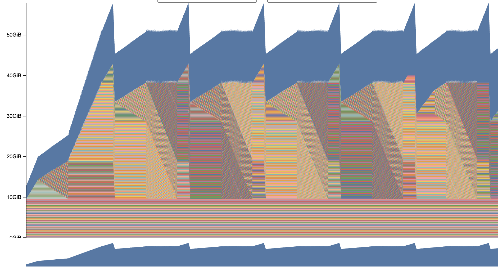
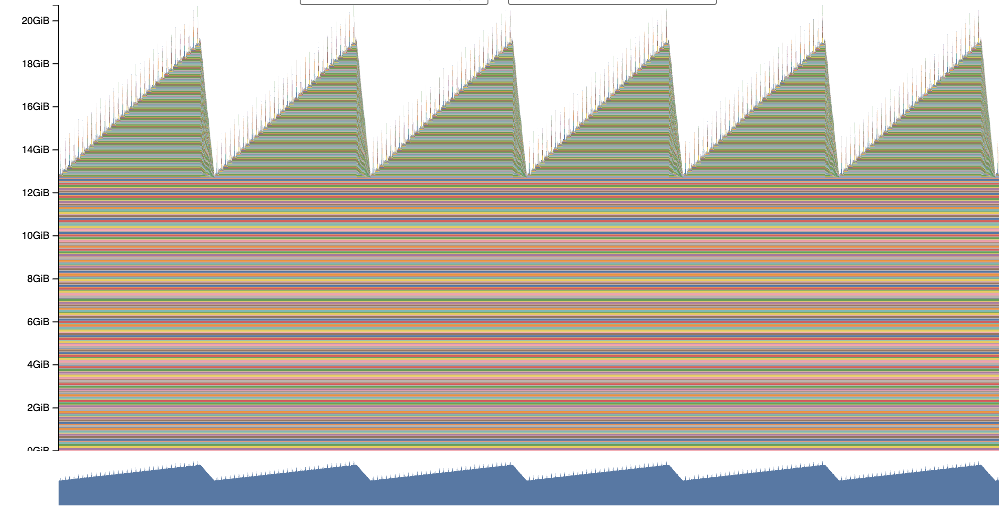
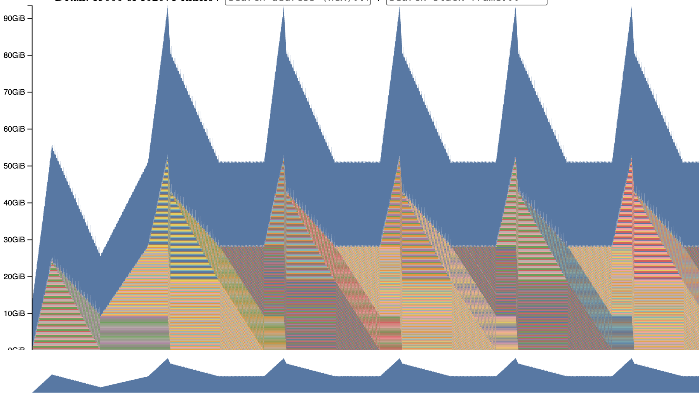

# Problem memory_profiling

## a.

### Without mixed precision

| Context length | Forward | Full train step |
| --- | --- | --- |
| 128 |  |  |
| 2048 |  |  |

### With mixed precision

| Context length | Forward | Full train step |
| --- | --- | --- |
| 128 |  |  |
| 2048 |  |  |

As for the distinguishing stages - we can do so only with mixed precision, without - the graphics are identical

## b.

### Peak memory, GiB

| Context length | Forward | Full train step |
| --- | --- | --- |
| 128 | 12.7 | 52.2 |
| 2048 | 15.0 | 102.5 |

## c.

### Peak memory, mixed precision, GiB

| Context length | Forward | Full train step |
| --- | --- | --- |
| 128 | 19.0 | 58.0 |
| 2048 | 20.7 | 93.5 |

We can't see any singnificant memory usage drop here: 12.7 -> 19.0 and 15 -> 20.7 for forward only setup(so, basically, there's growth, not decline). 

As for the full training step, for small context lenghth we can't see decrease: 52.2 vs 58 GiB, but for larger seq len we see savings of aroung 9GiB.

## d.

As I understand, we're talking about x or y or z tensor inside transformer block, where

* x - input to the block
* y = x + attention(norm(x))
* z = y + ffn(norm(y))

Each of these tensors have the size of [batch_size, seq_len, d_model]

So, for our setup(bs = 1, seq_len = 128/2048 and d_model = 2560) we can state 

1) 1 * 128 * 2560 = 327680 params, each weights 4bytes => 327680 * 4bytes = 1310720 bytes = 1.25 MiB

2) 1 * 2048 * 2560 = 5242880 params, 4 bytes each => 20971520 bytes = 20 MiB

## e.

Having such trace(one of the most "fat" in terms of memory):

> 34 Addr: b'2add00000000_0, Size: 512.0MiB (536870912 bytes) allocation, Total memory used after allocation: 13.4GiB (14369662976 bytes), Compile context: N/A, stream 0, pool_id (0, 0), timestamp Thu Oct 29 2026 18:39:14 GMT+0100 (Central European Standard Time)
CUDACachingAllocator.cpp:0:c10::cuda::CUDACachingAllocator::Native::DeviceCachingAllocator::malloc(unsigned long, CUstream_st*)
:0:c10::cuda::CUDACachingAllocator::Native::NativeCachingAllocator::malloc(void**, signed char, unsigned long, CUstream_st*)
:0:c10::cuda::CUDACachingAllocator::Native::NativeCachingAllocator::allocate(unsigned long)
??:0:at::detail::empty_generic(c10::ArrayRef<long>, c10::Allocator*, c10::DispatchKeySet, c10::ScalarType, std::optional<c10::MemoryFormat>)
??:0:at::detail::empty_cuda(c10::ArrayRef<long>, c10::ScalarType, std::optional<c10::Device>, std::optional<c10::MemoryFormat>)
??:0:at::detail::empty_cuda(c10::ArrayRef<long>, std::optional<c10::ScalarType>, std::optional<c10::Layout>, std::optional<c10::Device>, std::optional<bool>, std::optional<c10::MemoryFormat>)
??:0:at::detail::empty_cuda(c10::ArrayRef<long>, c10::TensorOptions const&)
RegisterCUDA_0.cpp:0:at::(anonymous namespace)::create_out(c10::ArrayRef<long>, c10::ArrayRef<long>, c10::TensorOptions const&)
RegisterCUDA_0.cpp:0:at::(anonymous namespace)::structured_bmm_out_cuda_functional::set_output_raw_strided(long, c10::ArrayRef<long>, c10::ArrayRef<long>, c10::TensorOptions, c10::ArrayRef<at::Dimname>)
??:0:at::meta::structured_bmm::meta(at::Tensor const&, at::Tensor const&)
RegisterCUDA_0.cpp:0:c10::impl::wrap_kernel_functor_unboxed_<c10::impl::detail::WrapFunctionIntoFunctor_<c10::CompileTimeFunctionPointer<at::Tensor (at::Tensor const&, at::Tensor const&), &at::(anonymous namespace)::wrapper_CUDA_bmm>, at::Tensor, c10::guts::typelist::typelist<at::Tensor const&, at::Tensor const&> >, at::Tensor (at::Tensor const&, at::Tensor const&)>::call(c10::OperatorKernel*, c10::DispatchKeySet, at::Tensor const&, at::Tensor const&)
??:0:at::_ops::bmm::redispatch(c10::DispatchKeySet, at::Tensor const&, at::Tensor const&)
VariableType_3.cpp:0:torch::autograd::VariableType::(anonymous namespace)::bmm(c10::DispatchKeySet, at::Tensor const&, at::Tensor const&)
VariableType_3.cpp:0:c10::impl::wrap_kernel_functor_unboxed_<c10::impl::detail::WrapFunctionIntoFunctor_<c10::CompileTimeFunctionPointer<at::Tensor (c10::DispatchKeySet, at::Tensor const&, at::Tensor const&), &torch::autograd::VariableType::(anonymous namespace)::bmm>, at::Tensor, c10::guts::typelist::typelist<c10::DispatchKeySet, at::Tensor const&, at::Tensor const&> >, at::Tensor (c10::DispatchKeySet, at::Tensor const&, at::Tensor const&)>::call(c10::OperatorKernel*, c10::DispatchKeySet, at::Tensor const&, at::Tensor const&)
??:0:at::_ops::bmm::call(at::Tensor const&, at::Tensor const&)
Linear.cpp:0:at::native::sumproduct_pair(at::Tensor const&, at::Tensor const&, c10::ArrayRef<long>, bool) [clone .constprop.0]
??:0:at::native::einsum(std::basic_string_view<char, std::char_traits<char> >, c10::ArrayRef<at::Tensor>, c10::OptionalArrayRef<long>)
RegisterCompositeImplicitAutograd_0.cpp:0:c10::impl::wrap_kernel_functor_unboxed_<c10::impl::detail::WrapFunctionIntoFunctor_<c10::CompileTimeFunctionPointer<at::Tensor (std::basic_string_view<char, std::char_traits<char> >, c10::ArrayRef<at::Tensor>, c10::OptionalArrayRef<long>), &at::(anonymous namespace)::(anonymous namespace)::wrapper_CompositeImplicitAutograd__einsum>, at::Tensor, c10::guts::typelist::typelist<std::basic_string_view<char, std::char_traits<char> >, c10::ArrayRef<at::Tensor>, c10::OptionalArrayRef<long> > >, at::Tensor (std::basic_string_view<char, std::char_traits<char> >, c10::ArrayRef<at::Tensor>, c10::OptionalArrayRef<long>)>::call(c10::OperatorKernel*, c10::DispatchKeySet, std::basic_string_view<char, std::char_traits<char> >, c10::ArrayRef<at::Tensor>, c10::OptionalArrayRef<long>)
??:0:at::_ops::einsum::call(std::basic_string_view<char, std::char_traits<char> >, c10::ArrayRef<at::Tensor>, c10::OptionalArrayRef<long>)
python_torch_functions_0.cpp:0:torch::autograd::THPVariable_einsum(_object*, _object*, _object*)
/workspace/assignment2-systems/.venv/lib/python3.13/site-packages/torch/functional.py:373:einsum
/workspace/assignment2-systems/.venv/lib/python3.13/site-packages/einops/_backends.py:291:einsum
/workspace/assignment2-systems/.venv/lib/python3.13/site-packages/einops/einops.py:939:einsum
/workspace/stanford-cs336-assignment1-basics/cs336_basics/transformer.py:160:sdpa
??:0:PySeqIter_New
/workspace/stanford-cs336-assignment1-basics/cs336_basics/transformer.py:229:forward
/workspace/assignment2-systems/.venv/lib/python3.13/site-packages/torch/nn/modules/module.py:1790:_call_impl
/workspace/assignment2-systems/.venv/lib/python3.13/site-packages/torch/nn/modules/module.py:1779:_wrapped_call_impl
??:0:PySeqIter_New
/workspace/stanford-cs336-assignment1-basics/cs336_basics/transformer.py:254:forward
/workspace/assignment2-systems/.venv/lib/python3.13/site-packages/torch/nn/modules/module.py:1790:_call_impl
/workspace/assignment2-systems/.venv/lib/python3.13/site-packages/torch/nn/modules/module.py:1779:_wrapped_call_impl
??:0:PySeqIter_New
/workspace/stanford-cs336-assignment1-basics/cs336_basics/transformer.py:301:forward
??:0:_Py_write
??:0:PyErr_WarnExplicitObject
??:0:PyImport_GetMagicNumber
??:0:Py_RunMain
??:0:Py_BytesMain
??:0:__libc_init_first
/workspace/assignment2-systems/.venv/lib/python3.13/site-packages/torch/nn/modules/module.py:1790:_call_impl
/workspace/assignment2-systems/.venv/lib/python3.13/site-packages/torch/nn/modules/module.py:1779:_wrapped_call_impl
/workspace/assignment2-systems/cs336_systems/profile_code.py:61:run_profile_timeit
/workspace/assignment2-systems/cs336_systems/profile_code.py:133:bench_all
/workspace/assignment2-systems/cs336_systems/profile_code.py:193:<module>

I can say that

1) 512MiB - size of allocated memory
2) transformer.py:160:sdpa - function inside my code and line number where allocation called
3) einops.py:939:einsum - for einsum result it was allocated, I guess bmm result, to be more precise